# Theme Settings

Every setting the theme adds lives on one screen: **Settings → Theme Settings**. This page walks through each tab, what its fields do and where the result shows on your site. Screenshots are from Cobble & Candle 1.5.1 on a new site.

The menu on the left of the screen has three groups:

- **Set up your site**: Brand, Look, Fonts, Content, Pages & menus and the Checklist. These take a new site from install to open, in order, and count toward the progress bar. You can come back to any of them later.
- **Features and services**: Blocks, Connect services, Newsletter and Social & sharing. Set these any time, in any order. Each tab saves on its own.
- **Support**: the guides you are reading now, plus **Create a ticket**.

Nothing on this screen deletes or overwrites content you already have.

## Brand

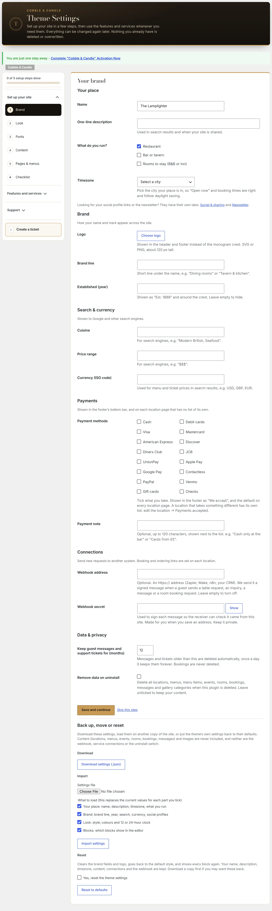

**Your place**

| Field | What it does |
| --- | --- |
| Name | The name of your place (your WordPress site title). |
| One-line description | Used in search results and when your site is shared. |
| What do you run? | Tick **Restaurant**, **Bar or tavern** and **Rooms to stay (B&B or inn)**. Tick all that apply. The setup follows your answer: the checklist only asks for rooms when you tick Rooms to stay. |
| Timezone | Pick the city your place is in, so “Open now” and booking times are right and follow daylight saving. |

**Brand**

| Field | What it does |
| --- | --- |
| Logo | Shown in the header and footer instead of the monogram crest. SVG or PNG, about 120 px tall. |
| Brand line | A short line under the name, such as “Dining rooms” or “Tavern & kitchen”. |
| Established (year) | Shown as “Est. 1888” and around the crest. Leave empty to hide. |

**Search & currency**

| Field | What it does |
| --- | --- |
| Cuisine | For search engines, such as “Modern British, Seafood”. |
| Price range | For search engines, such as “$$$”. |
| Currency (ISO code) | Used for menu and ticket prices in search results: USD, GBP, EUR. |

**Payments**

| Field | What it does |
| --- | --- |
| Payment methods | Tick what you take: Cash, Debit cards, Visa, Mastercard, American Express, Discover, Diners Club, JCB, UnionPay, Apple Pay, Google Pay, Contactless, PayPal, Venmo, Gift cards, Checks. Shown in the footer as “We accept” and used as the default on every location page. |
| Payment note | Optional, up to 120 characters, shown next to the list: “Cash only at the bar”. |

A location that takes something different has its own list. See [Branding & styles](branding-and-styles.md#footer-legal-links-and-payments) and [Locations & hours](locations-and-hours.md#payments-accepted).

**Connections**

| Field | What it does |
| --- | --- |
| Webhook address | Optional. An `https://` address (Zapier, Make, n8n, your CRM). The site sends it a signed message when a guest sends a table request, an inquiry, a message or a room booking request. Leave empty to turn off. |
| Webhook secret | Signs each message so the receiver can check it came from your site. Made for you when you save an address. Keep it private. |

Details are in [Send requests to another system](webhooks.md). Booking and ordering links are set on each location, not here.

**Data & privacy**

| Field | What it does |
| --- | --- |
| Keep guest messages and support tickets for (months) | Older messages and tickets are deleted automatically, once a day. 0 keeps them forever. Bookings are never deleted. |
| Remove data on uninstall | When ticked, deleting the Core plugin also deletes your locations, menus, menu items, events, rooms, bookings, messages and gallery categories. Leave it unticked to keep your content. |

**Back up, move or reset**

- **Download** saves these settings as a `.json` file.
- **Import** loads a settings file. You choose which parts to load: your place, brand, look, or blocks. Each part you tick replaces the current values.
- **Reset** clears the brand fields and logo, goes back to the default style and shows every block again. Your name, description, timezone, content, connections and webhook are kept.

Content (locations, menus, events, rooms, bookings, messages) and images are never part of a settings file, so keep your usual site backups too.

## Look

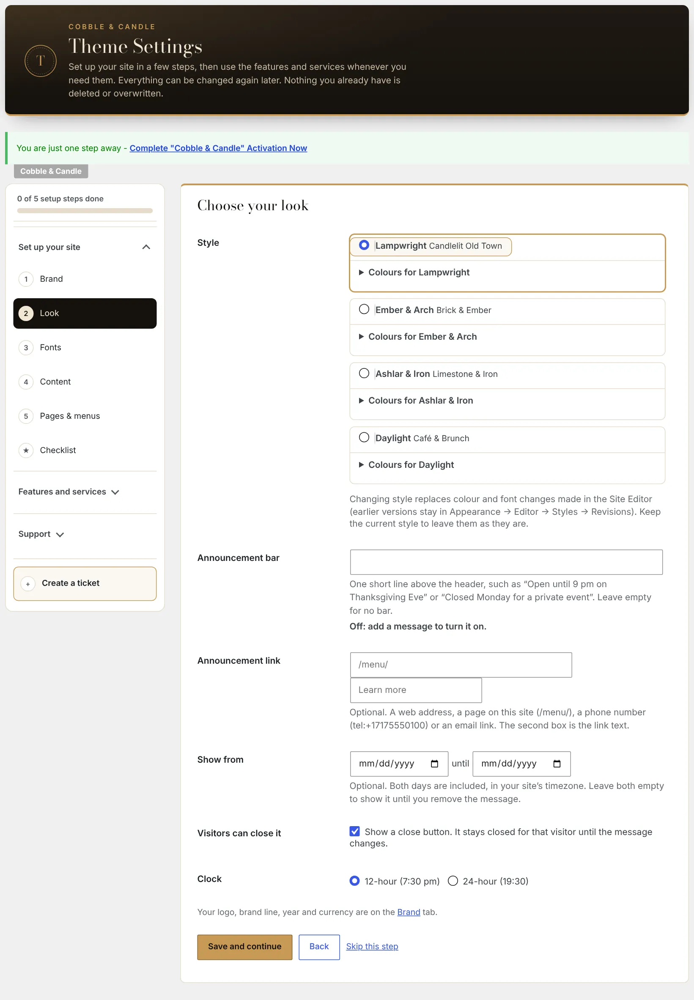

| Field | What it does |
| --- | --- |
| Style | One of four: **Lampwright** (Candlelit Old Town), **Ember & Arch** (Brick & Ember), **Ashlar & Iron** (Limestone & Iron) or **Daylight** (Café & Brunch). Each has a **Colours for…** panel under it. |
| Announcement bar | One short line above the header, such as “Open until 9 pm on Thanksgiving Eve”. Leave empty for no bar. |
| Announcement link and Link text | Optional. A web address, a page on your site (`/menu/`), a phone number (`tel:+17175550100`) or an email link, and the words to show for it. |
| Show from … until | Optional dates. Both days are included, in your site's timezone. Leave both empty to show the bar until you remove the message. |
| Visitors can close it | Adds a close button. It stays closed for that visitor until the message changes. |
| Clock | 12-hour (7:30 pm) or 24-hour (19:30). |

Changing style replaces colour and font changes made in the Site Editor. Earlier versions stay in **Appearance → Editor → Styles → Revisions**. More in [Branding & styles](branding-and-styles.md).

## Fonts

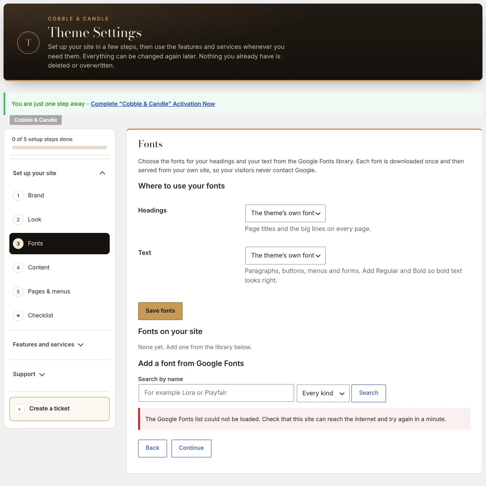

- **Headings**: page titles and the big lines on every page.
- **Text**: paragraphs, buttons, menus and forms. Add Regular and Bold so bold text looks right.
- **Fonts on your site**: the fonts you have added.
- **Add a font from Google Fonts**: search by name, or by kind (Serif, Sans serif, Display, Handwriting, Monospace).

Both pickers start on **The theme's own font**. The full walk-through is in [Fonts](fonts.md).

## Content

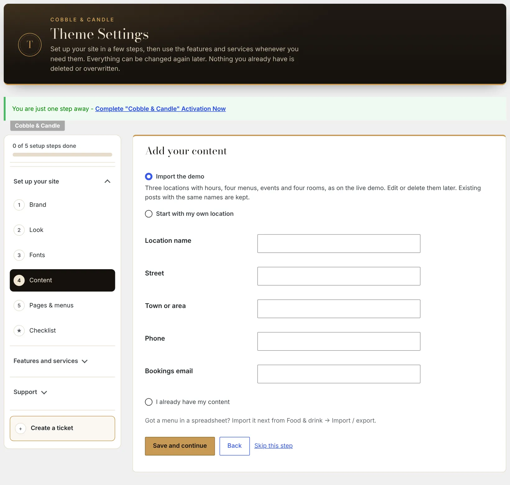

Pick one of three starting points:

- **Import the demo**: three locations with hours, four menus, events and four rooms, as on the live demo. Edit or delete them later. Existing posts with the same names are kept.
- **Start with my own location**: enter the location name, street, town or area, phone and bookings email.
- **I already have my content**: skips this step.

Have a menu in a spreadsheet? Import it next from **Food & drink → Import / export** ([Menus](menus.md)).

## Pages & menus

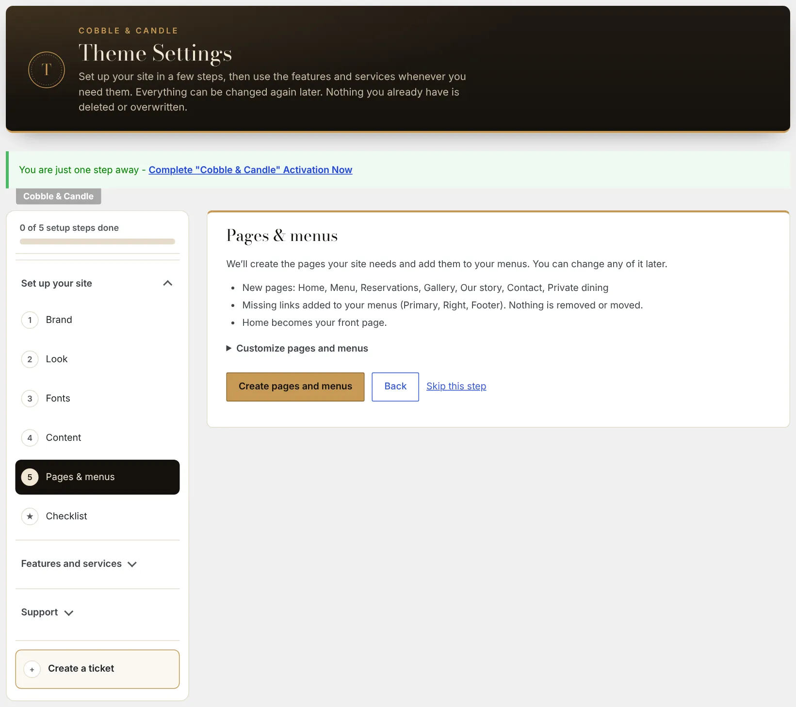

**Create pages and menus** makes the pages your site needs (Home, Menu, Reservations, Gallery, Our story, Contact, Private dining), adds any missing links to your Primary, Right and Footer menus, and sets Home as your front page. Nothing is removed or moved. Open **Customize pages and menus** to tick which pages to create and, for each new page, choose its sections and type your own heading, intro and text.

Run it again after you publish a legal page (privacy policy, terms, accessibility statement) and it adds the link to the footer. See [Branding & styles](branding-and-styles.md#footer-legal-links-and-payments).

## Checklist

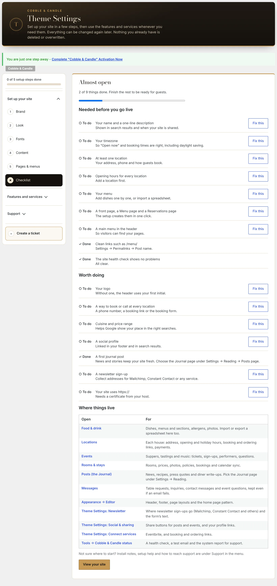

The checklist reads your site and tells you what is left:

- **Needed before you go live**: your name and a one-line description, your timezone, at least one location, opening hours for every location, your menu (and your rooms, if you offer them), a front page with a Menu page and a Reservations page, a main menu in the header, clean links such as `/menu/`, and a site health check with no problems. Each open item has a **Fix this** link.
- **Worth doing**: your logo, a way to book or call at every location, cuisine and price range, a social profile, a first journal post, a newsletter sign-up, and `https://`.
- **Where things live**: a table of every screen you will use day to day (Food & drink, Locations, Events, Rooms & stays, Posts, Messages, the Site Editor and the status page).

## Blocks

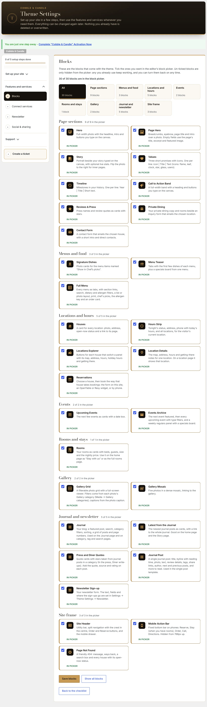

Lists the blocks the theme adds, grouped as Page sections, Menus and food, Locations and hours, Events, Rooms and stays, Gallery, Journal and newsletter, and Site frame. Untick a block to hide it from the block picker in the editor. A hidden block already on a page keeps working. **Show all blocks** puts them all back.

What each block does is in [Blocks](blocks.md).

## Connect services

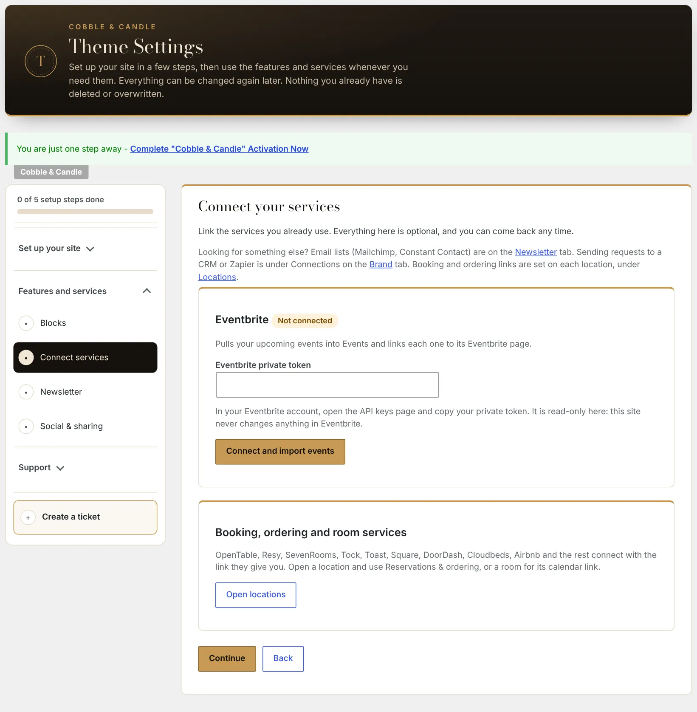

- **Eventbrite**: paste your Eventbrite private token and choose **Connect and import events**. Your upcoming events are pulled into Events, each linked to its Eventbrite page. It is read-only: the site never changes anything in Eventbrite.
- **Booking, ordering and room services**: OpenTable, Resy, SevenRooms, Tock, Toast, Square, DoorDash, Cloudbeds, Airbnb and the rest connect with the link they give you. Open a location and use **Reservations & ordering**, or open a room for its calendar link.

More in [Booking, ordering and other services](integrations.md).

## Newsletter

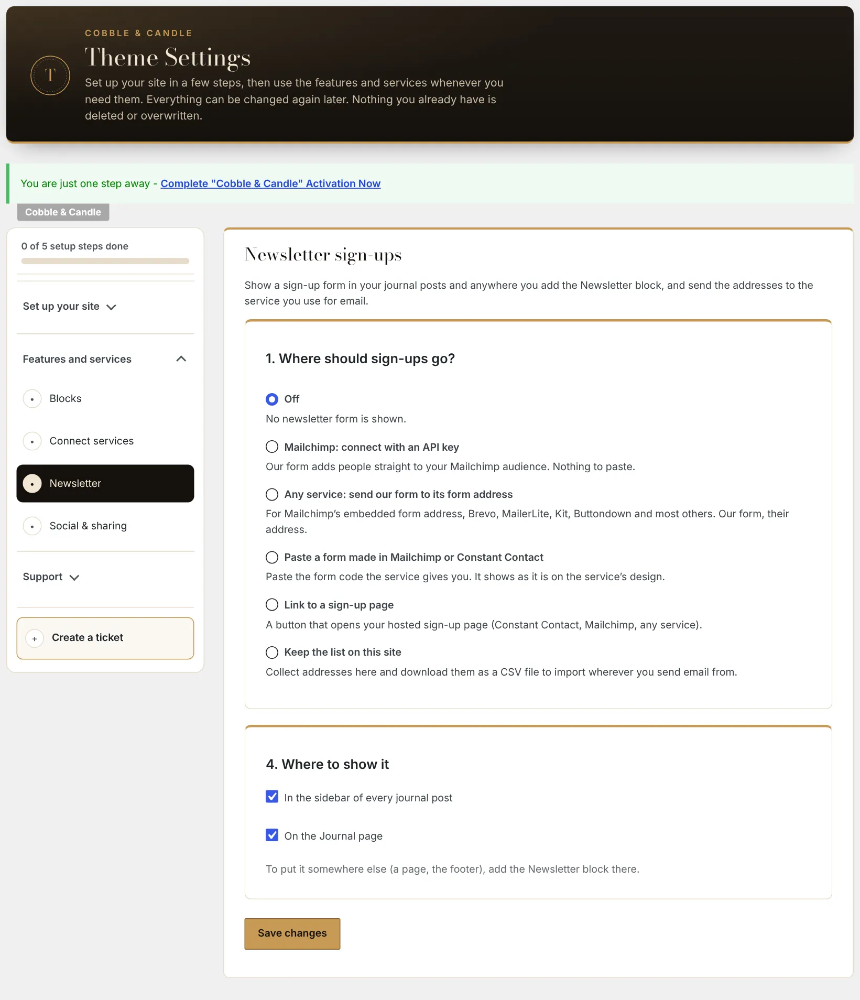

**1. Where should sign-ups go?**

| Choice | What happens |
| --- | --- |
| Off | No newsletter form is shown. |
| Mailchimp: connect with an API key | The theme's form adds people straight to your Mailchimp audience. |
| Any service: send our form to its form address | For Mailchimp's embedded form address, Brevo, MailerLite, Kit, Buttondown and most others. |
| Paste a form made in Mailchimp or Constant Contact | Shows the form code the service gives you, in the service's own design. |
| Link to a sign-up page | A button that opens your hosted sign-up page. |
| Keep the list on this site | Collects addresses here. Download them as a CSV file. |

The steps in between appear once you pick a choice. The last step, **Where to show it**, has two tick boxes: in the sidebar of every journal post, and on the Journal page. To put the form anywhere else, add the Newsletter block there.

Step-by-step setup for each service is in [Newsletter, share buttons and social links](newsletter.md).

## Social & sharing

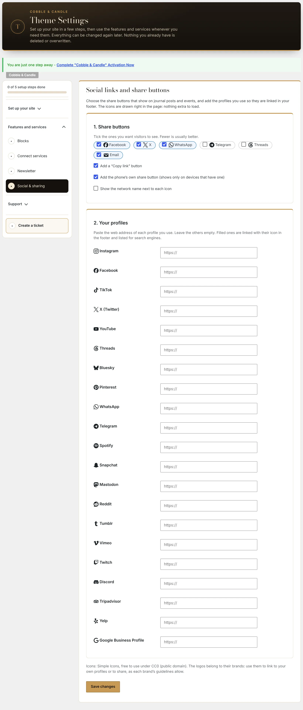

**1. Share buttons.** Tick the ones visitors should see: Facebook, X, WhatsApp, Telegram, Threads, Email. Three extras: a **Copy link** button, the phone's own share button (shown only on devices that have one), and the network name next to each icon.

**2. Your profiles.** Paste the web address of each profile you use and leave the rest empty: Instagram, Facebook, TikTok, X (Twitter), YouTube, Threads, Bluesky, Pinterest, WhatsApp, Telegram, Spotify, Snapchat, Mastodon, Reddit, Tumblr, Vimeo, Twitch, Discord, Tripadvisor, Yelp and Google Business Profile. Filled ones are linked with their icon in the footer and listed for search engines.

## Support

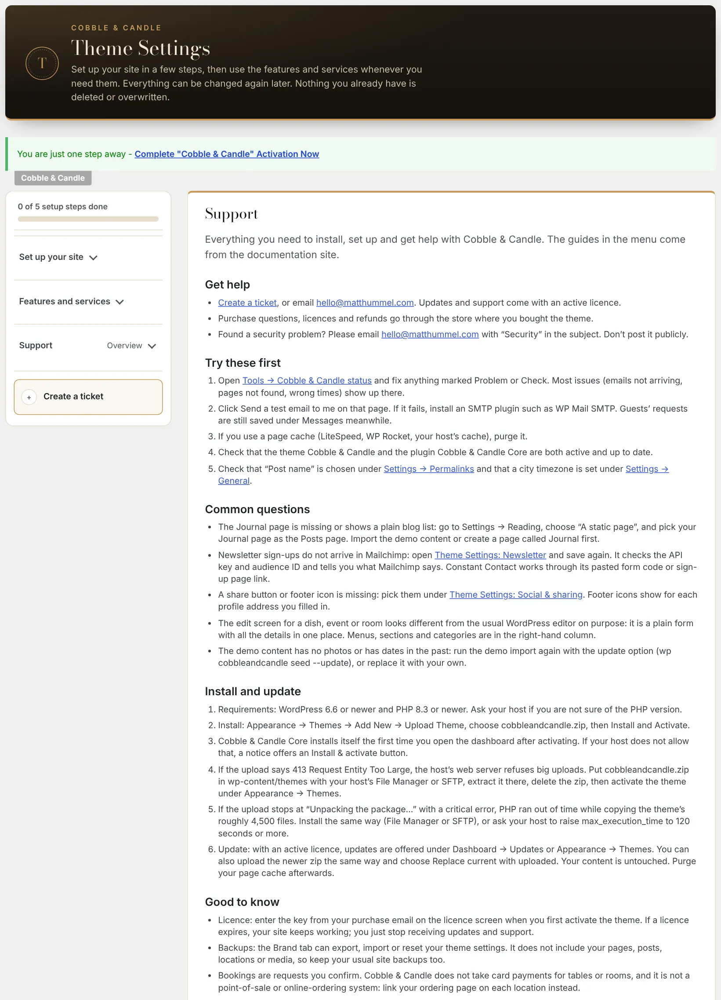

The Support tab shows these guides inside WordPress, with quick fixes to try first, install and update notes, and a **System report** to copy when you ask for help. The report lists versions and settings. It never includes passwords, email addresses or guest details.

**Create a ticket** sits under the menu on every tab. See [Support](support.md).
